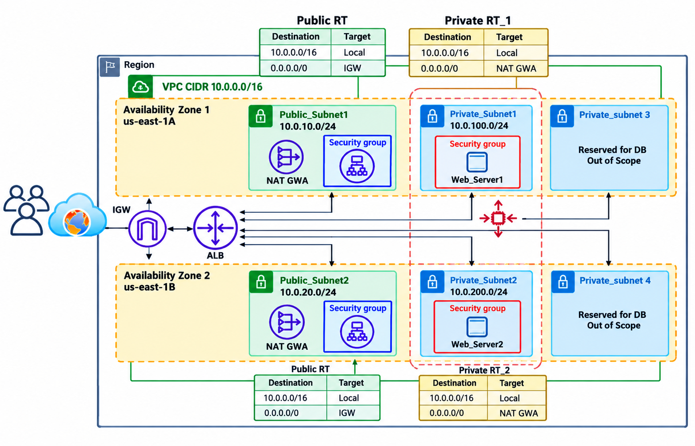

# Highly Available, Auto-Scaled Web Application on AWS

A multi-tier web application deployed in a custom VPC across two Availability Zones, with web servers in private subnets behind an Application Load Balancer, managed by an Auto Scaling Group.

## Architecture

## Key Features

- Custom VPC (`10.0.0.0/16`) with 2 public and 2 private subnets across 2 AZs
- Internet Gateway and 2 NAT Gateways, with a dedicated private route table per AZ
- Internet-facing Application Load Balancer with health-checked target group
- Launch Template and Auto Scaling Group (min 2, desired 4, max 6) with ELB health checks
- Access through AWS Systems Manager (SSM) instead of SSH keys
- Least-privilege security groups: web servers accept traffic only from the ALB

## Services Used

VPC, EC2, ALB, Auto Scaling, NAT Gateway, IAM, Systems Manager

## Documentation

The full report is in [Report.pdf](Report.pdf) (LaTeX source in `report-source/`).

## Acknowledgment

Implemented as a capstone project in the _AWS Core Services Introduction_ course by DolfinED.

## Author

Mosab Kamal
